# CAPA: The Basics — TryHackMe Writeup

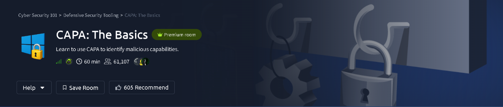

| | |
|---|---|
| **Platform** | [TryHackMe](https://tryhackme.com/room/capabasics) |
| **Path** | Cyber Security 101 → Defensive Security Tooling |
| **Room** | CAPA: The Basics (Premium) |
| **Time** | ~60 min |
| **Author** | [Shaurya Rathore](https://github.com/shauryarathore357-hub) |
| **Status** | Completed ✅ |

> **Spoiler policy:** every answer field in this writeup is blurred. The goal is to document the *technique* (which command, which output section, and how to reason from it), not to hand over answers. Follow the method and you'll land on them yourself.

---

## Overview

When a malware analyst gets an unknown executable, the first question is *"what can this thing do?"* before anyone fires up a debugger. **CAPA** (from Mandiant's FLARE team) answers that automatically. It statically analyses a binary, matches it against a library of community-written **YAML rules**, and reports human-readable **capabilities** such as "encrypt data using AES" or "create a service". Each capability is mapped to industry frameworks, so the output reads like a threat report rather than a wall of disassembly.

This room walks through CAPA's command-line options, then teaches the vocabulary of its output: **MITRE ATT&CK**, **MAEC**, **MBC**, and CAPA's own **rule namespaces**, using a real malware sample.

**Skills practised**

- Running CAPA and choosing the right verbosity level
- Reading the sample metadata block (hashes, format, architecture)
- Mapping capabilities to ATT&CK tactics, techniques and sub-techniques
- Interpreting MAEC malware categories
- Navigating the Malware Behavior Catalog (MBC) objectives and micro-behaviours
- Understanding CAPA's rule namespaces and the YAML rules behind each match
- Exporting results to JSON and exploring them in the browser

> ⚠️ **Safety note:** CAPA analyses statically and never executes the sample, but the file is still real malware. Keep it inside the lab VM.

---

## 1. Tool Usage: Learning the CLI

The sample for the room is `cryptbot.bin`, located in the `Room-CAPA` directory. The basic invocation is simply:

```bash
capa <path-to-sample>
```

The first thing to learn is how much detail you want. CAPA has three levels, and each one answers a different question:

| Command | What you get |
|---|---|
| `capa -h` | Help : lists every option the tool supports. Always the first stop with an unfamiliar tool. |
| `capa -v` | **Verbose** : detailed capability results, including *where* in the file each rule matched. |
| `capa -vv` | **Very verbose** : everything above plus the individual features and logic that triggered each rule. Use this when you need to *prove* why a capability was flagged. |

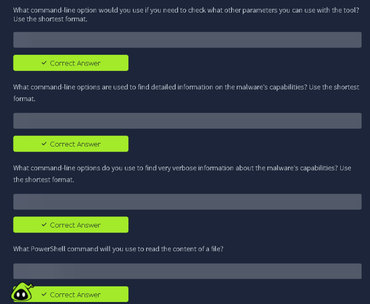

> 💡 **Tip:** Start with the default output for the big picture, drop to `-v` for the details you'll cite in a report, and reserve `-vv` for the one or two capabilities you actually need to verify.

<!-- OPTIONAL: add your own terminal screenshot of `capa -h` / `capa -v` here -->

---

## 2. Recon: Fingerprinting the Sample

Every CAPA run opens with a metadata table. This is your triage card for the file:

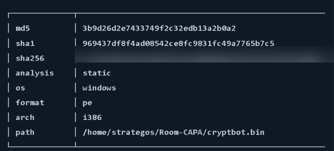

What it tells us:

| Field | Meaning |
|---|---|
| `md5` / `sha1` / `sha256` | Hashes of the sample. Use them to look it up on VirusTotal, MalwareBazaar, or your threat-intel platform, and to log the exact artifact in your report. |
| `analysis` | **static**: CAPA examined the file without running it. |
| `os` | **windows**: the sample targets Windows. |
| `format` | **pe**: a Portable Executable (`.exe` / `.dll`). |
| `arch` | **i386**: 32-bit x86. |
| `path` | Where the sample sits on the analysis machine: `/home/strategos/Room-CAPA/cryptbot.bin`. |

The sha256 value is blurred in the screenshot above because it is the answer to the room's hashing question, but it's right there in the first block of CAPA's output, no extra tooling needed.

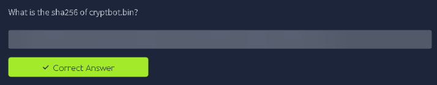

> 💡 **Why hashes first?** Hashes are the sample's identity. Before you analyse anything, record them. Every later finding is tied back to that exact file.

---

## 3. Reading the Results: MITRE ATT&CK

Below the metadata, CAPA lists matched capabilities grouped by framework. The first mapping is **MITRE ATT&CK**, which describes *adversary behaviour*. CAPA prints each entry in a fixed format:

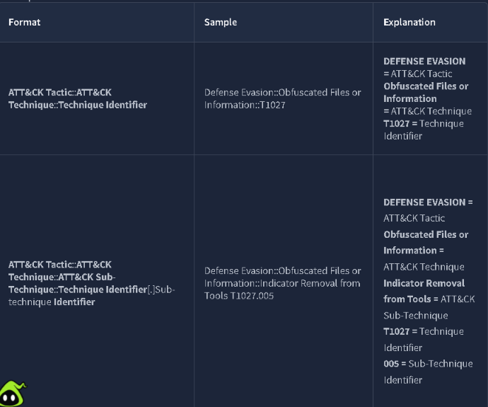

| Format | Example structure |
|---|---|
| Technique | `Tactic::Technique::Technique ID` |
| Sub-technique | `Tactic::Technique::Sub-technique::Technique ID.Sub-technique ID` |

Reading one left to right: the **tactic** is the attacker's *goal* (e.g. Defense Evasion), the **technique** is *how* they pursue it, the **sub-technique** is the specific variant, and the **ID** is the lookup key into the ATT&CK matrix. Sub-technique IDs append a `.NNN` suffix to the parent technique ID.

To answer the room's questions, find the named technique in CAPA's ATT&CK section (or on the MITRE ATT&CK site) and read off its identifier; for the sub-technique, check the child entry beneath it.

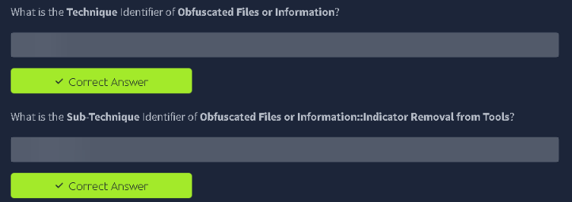

---

## 4. Reading the Results: MAEC

**MAEC** (Malware Attribute Enumeration and Characterization) is a standardised vocabulary for describing malware. CAPA uses it to put a one-word **category label** on the sample, based on the behaviours it finds:

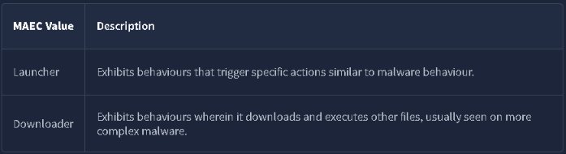

The room's reference table defines the labels. The method for the questions is to read each *behaviour description* and match it against the table's definitions:

- Behaviour that **triggers or sets off actions** (starting things, keeping a foothold on the system) points to one category.
- Behaviour that **pulls extra files or payloads from elsewhere** points to a different one.

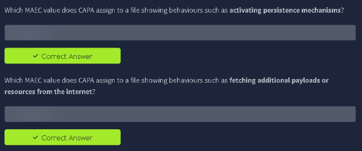

---

## 5. Reading the Results: Malware Behavior Catalog (MBC)

**MBC** is to malware analysts what ATT&CK is to threat hunters: a catalogue of malware-specific *objectives* and *behaviours*. It's organised in three levels, and the room's questions are about telling them apart:

| Level | What it is |
|---|---|
| **Objective** | The high-level goal the malware is pursuing. |
| **Behaviour** | A specific malware behaviour that serves an objective. Identifiers start with **B**. |
| **Micro-behaviour** | A low-level, reusable action (creating a process, encoding data, making an HTTP request). Identifiers start with **C**. |

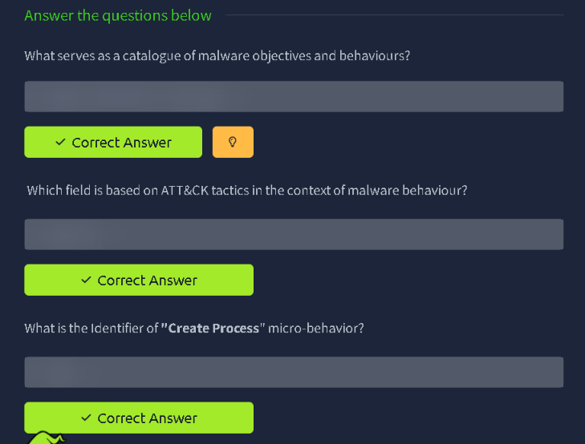

The practical approach: look up the identifier or description on the MBC website, or find it in CAPA's MBC output section. The prefix letter tells you which level you're looking at, and the matrix pages list the ID alongside the name.

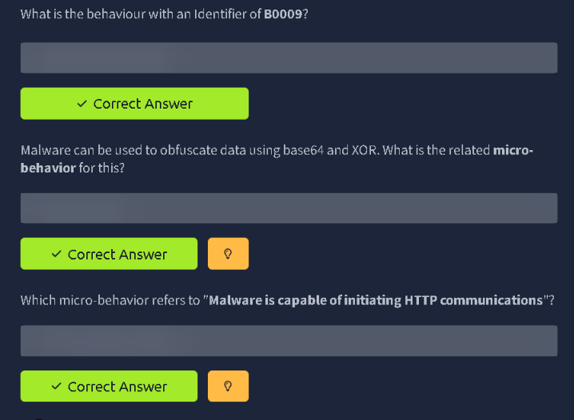

---

## 6. Understanding CAPA's Namespaces

Every CAPA rule lives in a **namespace**, a folder-style path that groups rules by purpose. Top-level namespaces (TLNs) describe the broad category (for example, rules about evading analysis, achieving persistence, or loading code), and sub-namespaces narrow it down with `/` separators. There's also a staging area for rules that aren't mature enough yet.

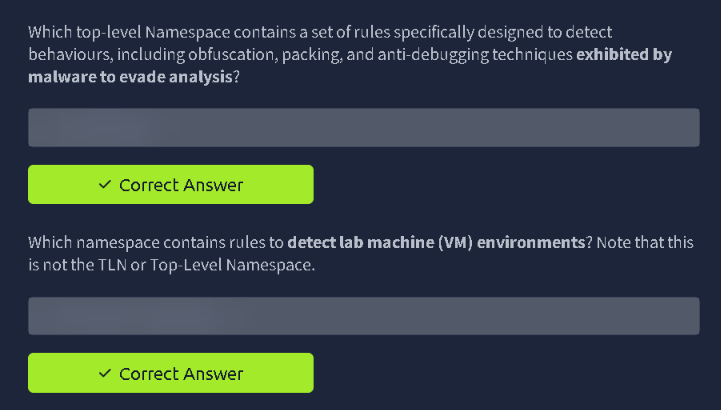

For the questions, read each description carefully: a TLN is the **first segment** of the path, while a full namespace includes the sub-categories after the slash. Pay attention to the wording of the question ("is not the TLN or Top-Level Namespace") to know which depth is expected.

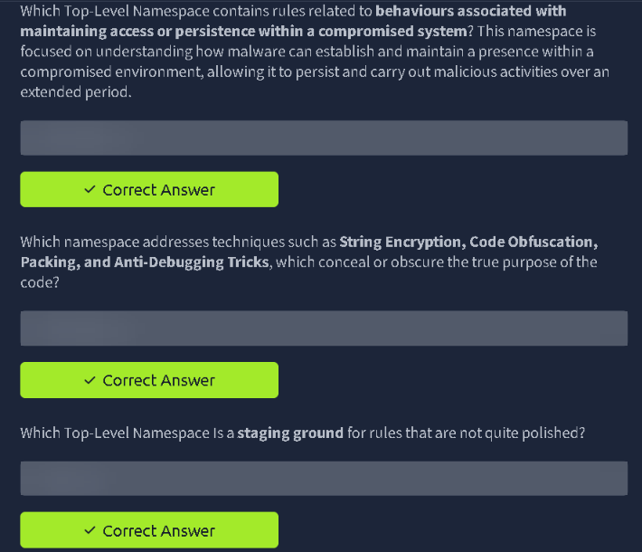

---

## 7. Going Deeper: Rule Files and Their Logic

Each capability CAPA reports comes from a **YAML rule file**. This is what makes CAPA transparent: you can open the rule and see exactly what it looks for. The rule file name usually mirrors the capability name (spaces become hyphens), and the capability name appears in the rule's `name:` field.

This is where `-vv` earns its keep. Very verbose output shows the matched rule and the evidence behind it, so you can go from *"CAPA says it checks HTTP status codes"* to *"here is the rule file and the logic that fired"*.

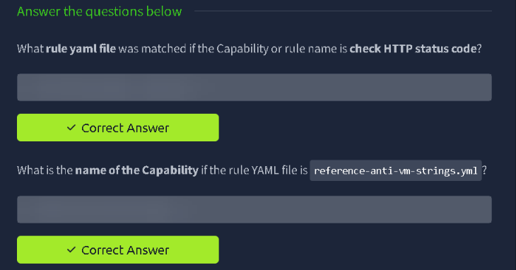

The last pair of questions asks you to inspect a rule's logic yourself:

1. Identify the top-level namespace of a given capability (look at where the rule sits in the tree).
2. Open the referenced rule file (linked in the room, or readable locally with PowerShell's `Get-Content`) and read its `features:` / conditions block to find the Windows API name the question describes. In this case, look for an API call whose name ends in `Ex`.

```powershell
Get-Content .\<rule-file>.yml
```

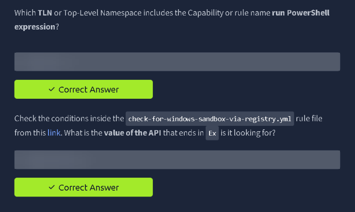

> 💡 **Why this matters:** reading rule logic is how you decide whether a CAPA hit is a genuine capability or a false positive. A rule that looks for a registry key access *plus* a specific string is far stronger evidence than one that matches a single common API call.

<!-- OPTIONAL: add your own terminal screenshot of the YAML rule being read here -->

---

## 8. Sharing Results: JSON Export and the Browser Explorer

For anything beyond a quick triage, you'll want CAPA's results in a portable format. The `-j` flag writes the output as **JSON**:

```bash
capa -j <path-to-sample> > cryptbot.json
```

That JSON can then be loaded into CAPA's **browser-based explorer**, an interactive viewer that lets you browse matched rules, drill into the namespaces and ATT&CK/MBC mappings, and filter the results using its search feature. It's much easier to hand to a teammate than a terminal dump.

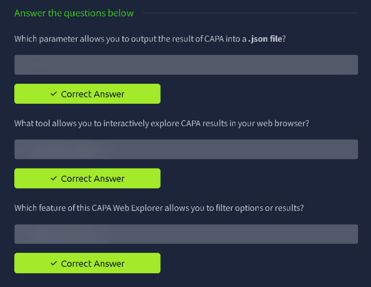

---

## Key Takeaways

1. **Triage in layers.** Hashes and metadata first, then capabilities, then the rule logic behind the ones that matter.
2. **Verbosity is a dial.** `-h` to discover, `-v` for evidence, `-vv` for proof.
3. **CAPA speaks three "languages":** ATT&CK (adversary behaviour), MAEC (malware category), and MBC (malware objectives and micro-behaviours). Knowing which one you're reading changes how you use it.
4. **Identifier prefixes carry meaning.** `T` = ATT&CK technique, `B` = MBC behaviour, `C` = MBC micro-behaviour.
5. **Rules are readable.** Because every capability maps to a YAML file, you can audit CAPA's conclusions instead of trusting them blindly.
6. **Static ≠ complete.** CAPA only sees what's in the file. Packed or heavily obfuscated samples can hide capabilities, so treat CAPA as a strong first pass, not the final word.

## Tools Used

- [CAPA](https://github.com/mandiant/capa): capability detection for executables
- [MITRE ATT&CK](https://attack.mitre.org/) and [Malware Behavior Catalog](https://github.com/MBCProject/mbc-markdown): reference frameworks
- PowerShell `Get-Content`: reading rule files

## What's Next

On to the next room in the **Defensive Security Tooling** module. Follow along on [TryHackMe](https://tryhackme.com/p/shauryarathore357) and [GitHub](https://github.com/shauryarathore357-hub).

---

*Writeup by Shaurya Rathore. Answers intentionally redacted. Do the room yourself, it's worth the hour.*
